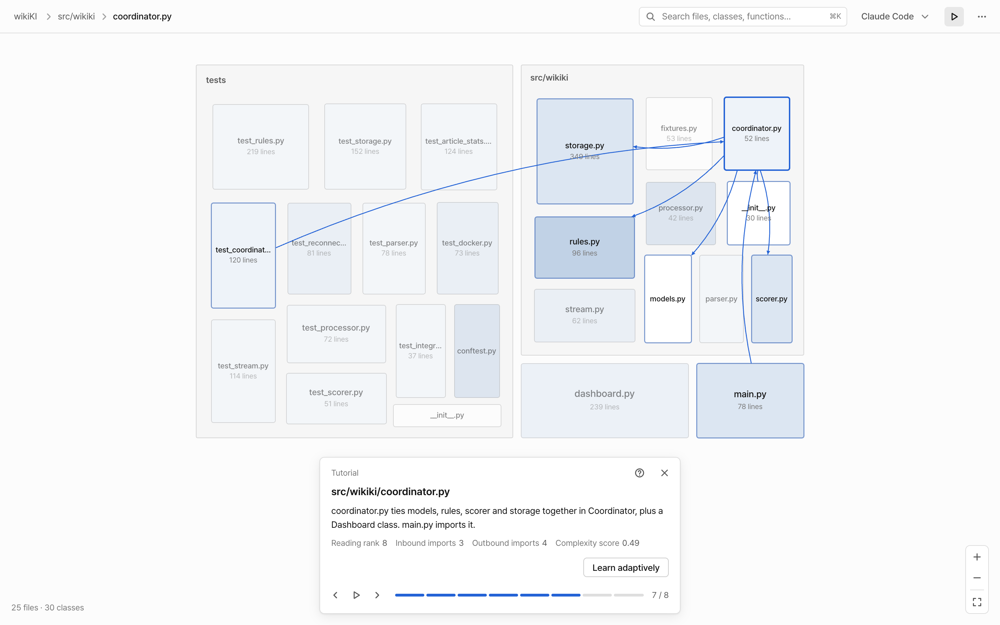
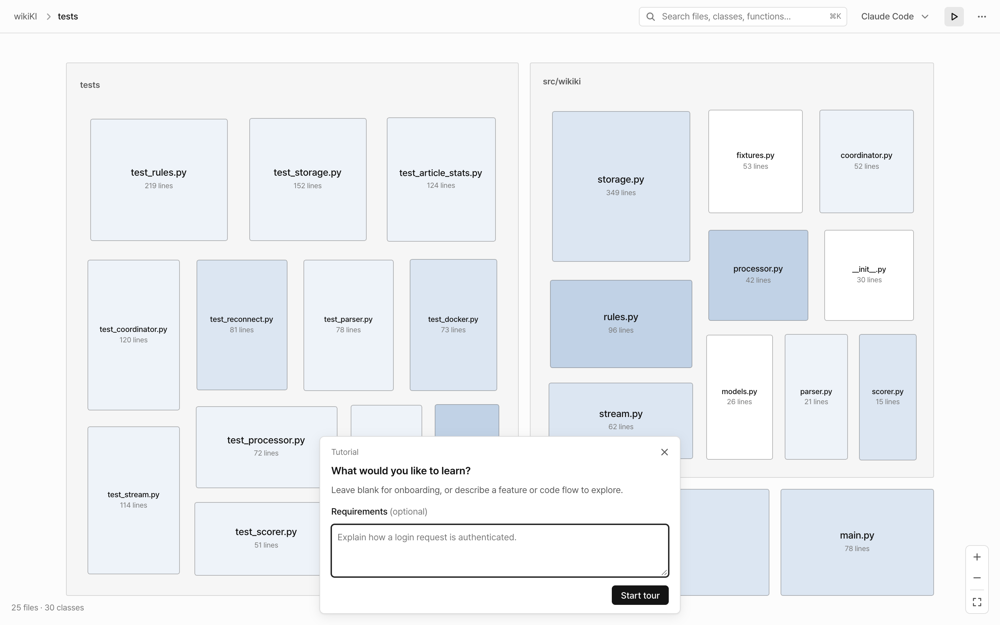
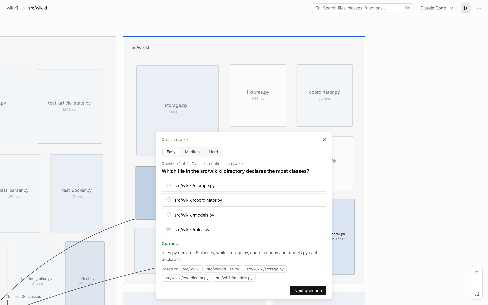

# Telescode

> A telescope for your codebase.

Open a Python repository and see it as a zoomable map. An AI agent then walks you through it in a sensible order and quizzes you on what you read.



## Why

AI writes code faster than people can understand it. The bottleneck is no longer writing code but understanding it: where to start, what depends on what, and which parts are hard. Telescode answers those questions visually and turns them into a guided reading path.

## Features

- **Code map.** Folders are regions and files are boxes sized by their line count. Darker boxes are more complex. Zoom in and files open into classes, fields and methods. Select a file to see only its own connections.
- **Reading order.** A LambdaRank model ranks files by what to read first. It combines graph centrality (PageRank, betweenness, personalized PageRank), complexity metrics and how well each file matches your goal (BM25).
- **AI tutorial.** Claude Code or Codex writes a guided tour along that order. Each step moves the map to a folder, file or class and explains why it matters.
- **Quizzes.** Any tutorial step can quiz you at easy, medium or hard. Questions are grounded in the code, and every answer comes with an explanation and the files it is based on.
- **Adaptive learning.** Describe what you want to learn, such as a feature or a code flow. The session estimates your understanding from your answers (Bayesian knowledge tracing) and picks the next step.

| Ask for a tour, or describe what to learn | Check your understanding |
|---|---|
|  |  |

## How it works

```text
GitHub URL or local folder
  │
  ▼  C++ core (TelescodeHeadless)
  │    parse with Tree-sitter → SQLite → complexity, dependency graph, centrality
  ▼  LambdaRank (ltr/)
  │    rank files for onboarding or for your goal
  ▼  MCP server (mcp/) ◀── Claude Code / Codex writes tours, quizzes and learning material
  │
  ▼  Desktop app (Tauri + React)
       draws the map and plays tours, quizzes and learning sessions on it
```

The MCP server never calls a model itself. The agent CLI you already use does the writing, with your own sign-in.

## Quick start

**Prerequisites:** CMake 3.20+ and a C++17 compiler, Python 3.11, Node.js 22+, Rust, and [Claude Code](https://claude.com/claude-code) or [Codex](https://github.com/openai/codex) for tutorials and quizzes.

```bash
# 1. Python environment for ranking (the C++ build also links its LightGBM)
python3.11 -m venv bench/.venv
bench/.venv/bin/pip install -r bench/requirements.txt

# 2. C++ core
cmake -S . -B build
cmake --build build --config Release --target TelescodeHeadless TelescodePPR

# 3. MCP server
npm --prefix mcp install

# 4. Desktop app
cd frontend
npm install
npm run desktop
```

Paste a public GitHub repository URL and press **Analyze**. Then press the play button in the top bar to start a tutorial. Choose Claude Code or Codex in the top bar; the app asks you to sign in only when it needs to generate something.

**Supported today:** public GitHub repositories and Python source. Development builds can also open a local folder. Generated tutorials are written in English.

## Repository layout

| Path | What it is |
|---|---|
| [`src/`](src/) | C++ core: parsing, SQLite storage, metrics, reading order, JSON output |
| [`frontend/`](frontend/) | Desktop app: Tauri shell and React UI, including the code map |
| [`mcp/`](mcp/) | MCP server for tours, quizzes and adaptive learning |
| [`ltr/`](ltr/) | LambdaRank model, feature extraction and runtime ranking |
| [`bench/`](bench/) | Ranking experiments and evaluation data |
| [`tests/`](tests/) | C++ tests (GoogleTest) |

Each part has its own README with setup details and checks:
[frontend](frontend/README.md) · [mcp](mcp/README.md) · [ltr](ltr/README.md).

## Tech stack

| Area | Technology |
|---|---|
| Core | C++17, CMake, Tree-sitter, SQLite |
| Ranking | LightGBM LambdaRank (Python training, native C++ inference) |
| Desktop | Tauri 2, React 19, TypeScript, Vite |
| AI | MCP server (Node.js), Claude Code or Codex CLI |

## Contributing

This project follows [GitHub Flow](https://docs.github.com/en/get-started/using-github/github-flow). Name branches `<type>/<issue-id>-<description>`, for example `feat/26-add-zoom`.

| Type | Purpose |
|---|---|
| `feat/` | New features |
| `fix/` | Bug fixes |
| `refactor/` | Code refactoring |
| `docs/` | Documentation changes |
| `chore/` | Miscellaneous tasks |

All PRs require a code review before merging.
